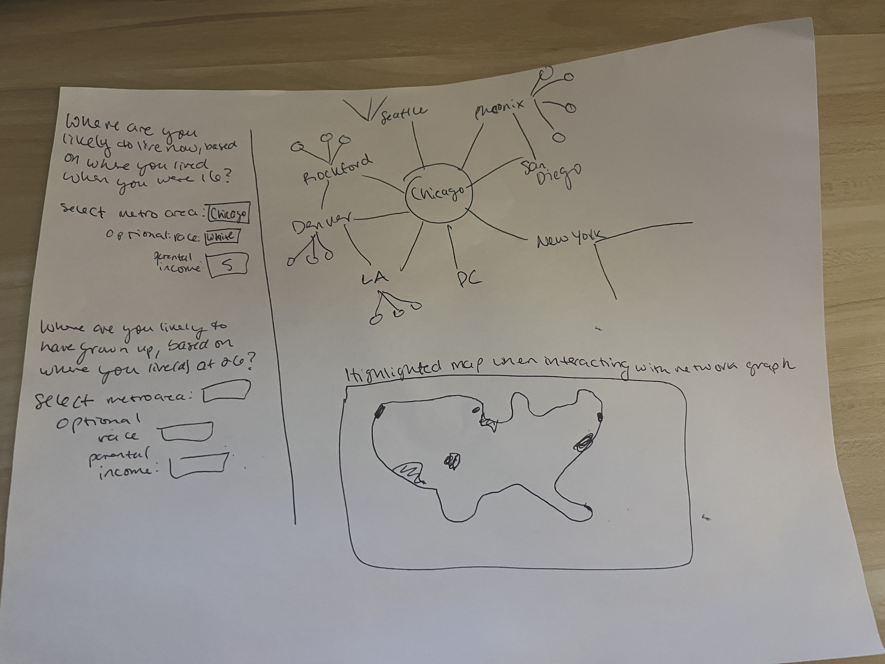

# Hannah Barton

## Description

I am continuing the project from my static visualization using migration data of young adults in America. I want to do a mix of a simulation and personalization project. Users will be able to input their home metro area, race, and parental income and then there will be a popup of where they are most likely to live now , or vice versa where they grew up. The user will also have an option to see a general simulation of movement of young adults across America. 

## Technical Plan re: Option A/B/C/D
I think I will mainly be doing Option A of either a map or network graph with connections between commuting zones, with options to look into patterns regarding race, urbanicity, region, and income. There might be a side panel that allows users to look into their own hometown's trends.

I will likely be using D3.js, I think the map functionality will not require something else.

The source of the data already has a great dashboard with a map displayig the data https://migrationpatterns.org/. 
I also found this NYT article with a similar research question: https://www.nytimes.com/interactive/2014/08/13/upshot/where-people-in-each-state-were-born.html?action=click&contentCollection=The%20Upshot&region=Footer&module=WhatsNext&version=WhatsNext&contentID=WhatsNext&moduleDetail=undefined&pgtype=Multimedia. I want to somehow combine both of these and add some element of movement. 

## Mockup

## Data Sources

{
include 1-3 data sources with the following,
you may re-use data sources from before or switch topics
}

### Data Source 1: Migration Patterns by Race and Parental Income

URL: https://opportunityinsights.org/data/?geographic_level=0&topic=0&paper_id=0#resource-listing

Size: 1,000,000 rows, 12 columns

Contains count and fractions of people who move between each origin and destination commuting zone pair separately by race/ethnicity and parental income quintile. These data are unique at the OD x race/ethnicity x parental income level. The Origin/Desination locations are at the Commuting Zone level. 

### Data Source 2 (if possible): County-Level (or Commuting Zone) Trends in Outcomes (1978-1992 Cohorts) by Parental Income, Race, and Gender

URL: https://opportunityinsights.org/data/?geographic_level=0&topic=0&paper_id=4687#resource-listing

Size: 3192 rows, 1000 columns

This dataset measures upward mobility by documenting the change in income and employment of parents and childrent between cohorts born in 1978 and 1992.

## Questions

